# 3. Solution design

**Status:** as-built design plus proposed pilot controls. Check unresolved choices with Ivan and RVL.

## 3.1 Design principles

- Keep one narrow workflow: project/sample registration through reviewed IHM draft.
- Use deterministic rules for clear cases and conflicts; ask AI only about eligible uncertain cases.
- Treat every automated match as a proposal. A named inspector reviews it.
- When evidence conflicts or output is invalid, abstain and explain why.
- Preserve enough evidence to trace the source report, processing version and human decision.
- Keep data fictitious unless the client approves another data path.

## 3.2 Data flow

```mermaid
flowchart LR
  U[Inspector] --> REG[Project and sample register]
  U --> IN[Paste text or upload PDF]
  IN -->|digital text| EX[Table extraction]
  IN -->|scanned page| OCR[Local OCR: Tesseract + Poppler]
  OCR --> EX
  EX --> ROWS[Extracted lab rows and warnings]
  REG --> RULES[Rule-based linker]
  ROWS --> RULES
  RULES -->|clear, conflict or unregistered| SAFE[Rule proposal or no-link]
  RULES -->|eligible uncertain rows| AI[AI step via client interface]
  AI --> CONTRACT[Validate response contract]
  CONTRACT --> MERGE[Hybrid merge and duplicate-link guard]
  SAFE --> REVIEW[Named inspector review]
  MERGE --> REVIEW
  REVIEW --> DEC[Append decision and audit evidence]
  DEC --> DRAFT[Draft IHM report / ODT export]
```

The diagram reflects code paths and documentation. OCR availability depends on local `tesseract` and `pdftoppm`; hosted deployment would need those dependencies installed and maintained. Replay is the default AI client; an optional Groq client has been added for fictional-data evaluation, but no live model result is yet recorded.

## 3.3 Component responsibilities

| Component | Responsibility | Current implementation |
|---|---|---|
| Browser UI and Python server | Project workflow, upload, review, report and local service logic | `app/static/index.html`, `app/server.py` |
| SQLite store | Project, sample, report, row, decision and history persistence | `james/store.py`, `schema.sql` |
| PDF extraction | Read text-layer PDFs; use OCR on pages without enough extractable text; rebuild simple table rows | `james/extract.py` |
| Rule linker | Normalise IDs, compare code families and descriptions, flag conflict and unregistered codes | `ai/james_ai/linker.py` |
| AI step and contract | Build prompt, call a client interface, parse and validate structured proposals | `ai/james_ai/ai_step.py`, `ai/james_ai/contract.py`, `contract/` |
| Hybrid and guard | Combine safe rule outcomes with eligible AI outcomes; prevent duplicate sample assignment | `ai/james_ai/hybrid.py` |
| IHM/report export | Prepare sections, thresholds and an ODT from approved data | `app/ihm.py`, `app/export_odt.py` |

## 3.4 Example flow

For a lab row such as `S02 | Exhaust pipe lagging, engine room | Asbestos not detected`, the extractor makes a row with ID, description and result. The linker normalises `S02` and compares it with the registered sample codes and descriptions. If the evidence supports `S-02`, it proposes that code with a reason. The inspector still checks the original report and register, then approves, corrects, rejects or defers the proposal. Only reviewed/approved information is used in the final report flow.

## 3.5 OCR design and limits

The extractor first tries the PDF text layer. A page with too few extracted words is rendered to an image and passed to Tesseract; word positions are then used to rebuild rows around recognised table headers. This is conventional OCR plus layout heuristics, not AI-based document understanding. The current implementation is documented as tested only on simple one-table layouts. It adds a page-level OCR warning, but it does not reliably identify confidence or uncertainty for every individual field. Therefore the design must show the extracted values next to the source image/text and require human verification, especially for codes, numbers, units and detection limits.

## 3.6 AI linking design and limits

The app sends a structured request containing the register and lab rows. The response must return one proposal per row, with a registered code or `null`, confidence and a short reason. The response validator checks the contract; broken output is rejected safely. Rules settle high-confidence matches and safety conflicts before the AI step. If rules and AI disagree, the hybrid can abstain. Groq is available only when explicitly selected; real report data remains gated on RVL approval.

The model is neither trained by this project nor allowed to sign off findings. AI-only links cannot label themselves high confidence; the hybrid caps them at medium. Prompt iterations and replay comparisons are recorded as experimentation; Groq's task accuracy still needs measurement.

## 3.7 Deployment boundary

The current app is a local prototype using Python's basic HTTP server and SQLite. A hosted pilot is technically possible, but this design does not yet specify production authentication, roles, encrypted storage, file retention/deletion, backups, monitoring, deployment automation or incident handling. These are design requirements for a future pilot, not existing capabilities.
